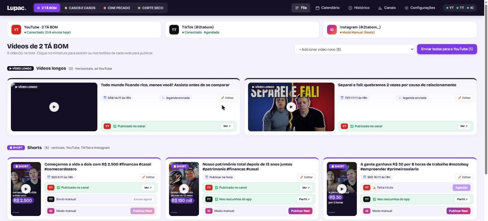
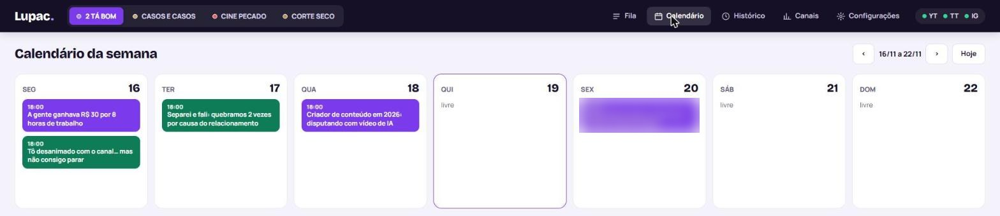
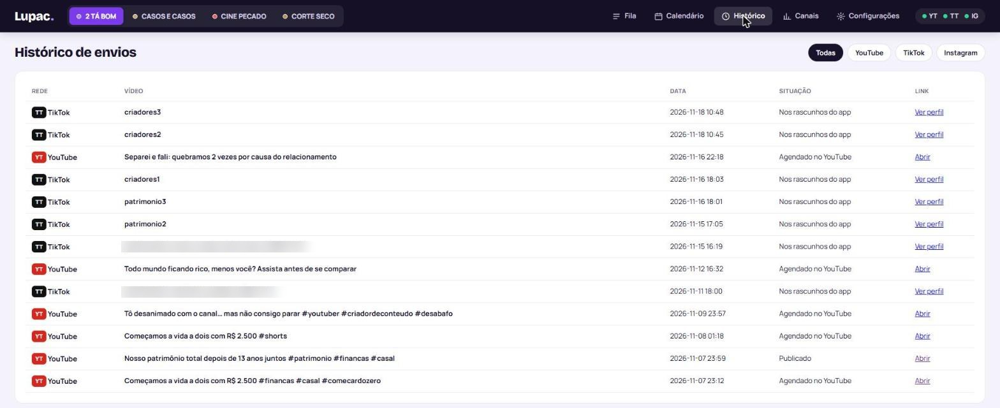
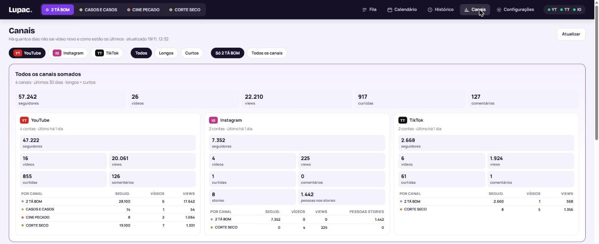
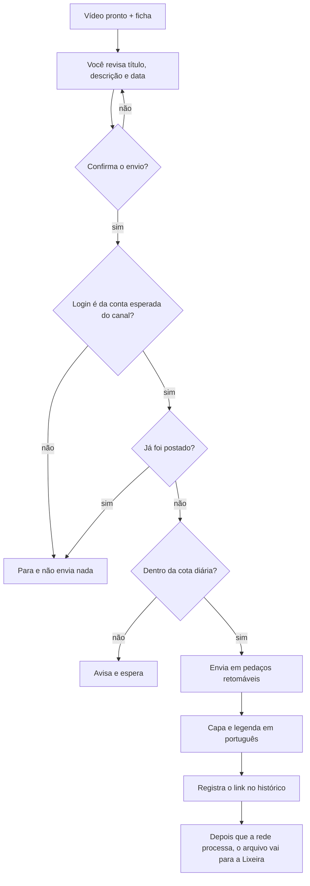

# Lupac

**Uma página para organizar e publicar os vídeos dos meus canais no YouTube, TikTok e Instagram.**
Você aprova título, descrição e data de cada vídeo, e o Lupac cuida do envio, do agendamento, da legenda e do registro.

> 🔒 **Código-fonte privado** (ferramenta que guarda logins das minhas contas). Este repositório é uma vitrine
> do projeto: o que ele faz, como foi construído e as decisões técnicas. Demonstração do código sob pedido.

## O que o Lupac faz

| | |
|---|---|
| **Fila** | Cada vídeo tem uma ficha com título, descrição, tags, capa e legenda. Você vê a prévia, edita e publica ou agenda. Vídeos longos e Shorts ficam em seções separadas. |
| **Calendário** | Visão da semana com tudo o que está agendado. Distribui os vídeos nos horários padrão de cada canal. |
| **Histórico** | Registro de cada envio, com data, situação e link. É ele que impede publicar o mesmo vídeo duas vezes. |
| **Canais** | Números de YouTube, Instagram e TikTok lado a lado: seguidores, vídeos, views e há quantos dias o canal não posta. |
| **Vários canais, um programa só** | Troca de canal na própria página. Cada canal guarda seus logins, configurações e histórico separados. |
| **Três redes** | YouTube pela API oficial, TikTok enviando para os rascunhos do app e Instagram pela Graph API, com modo manual para Reels. |
| **No celular** | A página se adapta à tela e abre pelo Wi-Fi de casa, protegida por uma chave. |

## Telas

| Calendário da semana |
|---|
|  |

| Histórico de envios |
|---|
|  |

| Painel dos canais |
|---|
|  |

> Capturas reais do painel, tratadas para publicação: títulos de vídeos ainda não publicados e nomes internos de arquivos foram borrados.

## Como um vídeo é publicado

## Decisões técnicas

- **Confirmação sempre:** nada é enviado sem a aprovação de título, descrição e data. Envia um vídeo por vez.
- **Trava contra conta errada:** cada canal tem a conta esperada na configuração. Se o login for de outra conta, o envio para e nada sai.
- **Sem duplicar:** o histórico de postados impede o segundo envio do mesmo vídeo.
- **Envio retomável:** arquivos grandes sobem em pedaços de 8 MB, e uma queda de conexão não obriga a recomeçar.
- **Respeita a cota da API:** limite diário de envios com aviso antes de estourar.
- **Barra de progresso real:** porcentagem, MB/s e tempo restante, mesmo quando o envio foi iniciado por linha de comando.
- **Falha não derruba o resto:** se a legenda falhar, o vídeo continua no ar e a página mostra o aviso.
- **Limpeza segura:** o arquivo local só vai para a Lixeira depois que a rede confirma que processou o vídeo. Se falhou, não apaga.
- **Segredos fora do código:** logins e tokens ficam na pasta de cada canal, nunca no repositório. O token do Instagram é renovado antes de vencer e o do TikTok é renovado sozinho.
- **Servidor em Python puro:** a página roda sem instalar framework. Só a biblioteca padrão do Python e as bibliotecas das APIs.
- **Liga com o Windows:** sobe escondido, sem janela. Fora do próprio computador, a página só abre com uma chave secreta.

## Em números

| | |
|---|---|
| Código | ~4,2 mil linhas de Python em 38 arquivos |
| Painel | servidor em Python puro (~550 linhas) e interface em HTML, CSS e JavaScript |
| Redes | YouTube, TikTok e Instagram |
| Canais | 4, gerenciados pela mesma página |

## Ferramentas de edição

O Lupac recebe os vídeos prontos de uma esteira de edição própria: transcrição com Whisper, cortes pelo som,
cartões e gráficos, Shorts verticais com legenda animada e capas. Uma parte dela está no
[estúdio de vídeos](https://github.com/lucianofonsecadev/estudio-de-videos).

## Tecnologias

**Python 3.12** · HTML · CSS · JavaScript · **YouTube Data API v3** (OAuth 2.0) · API de publicação do TikTok · Instagram Graph API · Whisper · FFmpeg · Pillow

## Páginas públicas

Os apps que usam as APIs do Google e do TikTok precisam de página de privacidade e termos. Elas ficam em
[`lupac`](https://github.com/lucianofonsecadev/lupac), [`postador-2tabom`](https://github.com/lucianofonsecadev/postador-2tabom)
e [`postador-corteseco`](https://github.com/lucianofonsecadev/postador-corteseco). O nome "Postador" é o que o app tem
cadastrado no Google; "Lupac" é o nome atual da plataforma.

---

Feito por <a href="https://github.com/lucianofonsecadev">Luciano Fonseca</a> · Brasília · <a href="https://www.youtube.com/@2tabom">youtube.com/@2tabom</a>

